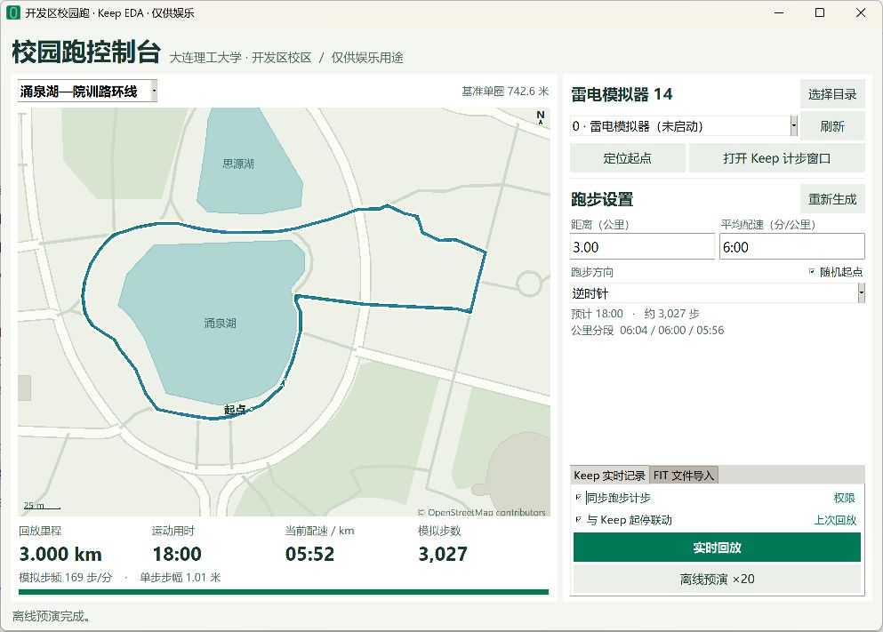
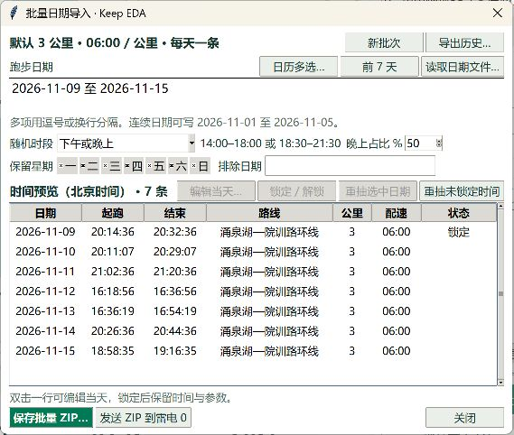
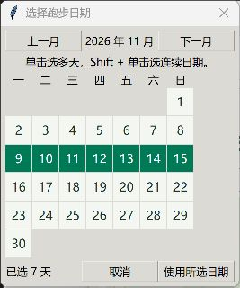

# 开发区校园跑 · Keep EDA

面向**大连理工大学开发区校区**的 Windows 跑步模拟工具，支持雷电 14 实时回放与 FIT 批量导出。

> [!IMPORTANT]
> **仅供娱乐用途及个人技术学习。** 所有生成、回放数据均为模拟数据，不代表真实运动。请勿用于学校考核、校园打卡、比赛排名或奖励申领。本项目与大连理工大学、Keep、雷电模拟器无官方关联。

[**下载 Windows 版**](https://github.com/rain-lei/Keep_EDA/releases/latest) · [使用与排查](docs/USAGE.md)

## 核心特色

| 特色 | 能做什么 |
| --- | --- |
| **校园路线定制** | 内置涌泉湖—院训路环线、校区田径场和离线地图；支持随机起点、顺逆时针及每圈走线变化。 |
| **配速与步态联动** | 起步、途中、收尾平滑衔接，步频与步幅随速度变化；20 倍预演、实时回放、FIT 导出共用同一份模拟数据。 |
| **定位、计步、方向同步** | 无需 root，通过 Android 14 虚拟传感器提供步数与朝向。电脑和 Keep 箭头跟随路线，转弯平滑，跨越正北不绕圈。 |
| **Keep 起停联动** | 电脑可直接启动 Keep 户外跑步，两端都能暂停、继续。控制台等 Keep 确认后恢复回放，到达目标时尝试自动暂停。 |
| **批量日期计划** | 日历多选、星期筛选、排除日期；支持下午／晚上等随机时段及晚上占比。逐天编辑、锁定或重抽，一天一个 FIT，打包 ZIP 导入。草稿与导出历史自动保存。 |

## 快速使用

默认 **3 公里 · 6:00 / 公里 · 18 分钟**。

1. **准备模拟器**：下载安装 [雷电模拟器 14](https://www.ldmnq.com/)（Android 14），在模拟器内安装并登录 Keep。
2. **完成设置**：开启雷电的本地 ADB 调试，按提示重启；允许 Keep 读取精确位置和身体活动。
3. **打开工具**：下载并解压 [Windows 版](https://github.com/rain-lei/Keep_EDA/releases/latest)，双击 `开发区校园跑.exe`，选择雷电实例与路线，无需安装 Python。
4. 点 **打开 Keep 计步窗口**，进入 Keep 的 **运动** 页。看到 **户外跑步** 和 **GO** 后，在电脑点一次 **同步开跑**。控制台会定位起点、点击 GO，并在倒计时结束后开始回放。

只想批量导出：打开 **FIT 文件导入 → 批量日期导入**，选择日期和时段，保存或发送 ZIP，再在 Keep 的运动数据文件导入页选择该 ZIP。

升级后请先关闭旧计步窗口，再从新版程序重新打开。回放时保持 Keep 跑步页面可见。

## 界面预览

以下为工具的离线预演与示例计划。

**校园路线与预演**

| 批量日期计划 | 日历多选 |
| --- | --- |
|  |  |

## 兼容与说明

- 实时模式需要 **Windows、雷电 14（Android 14）和本地 ADB**；起停联动已适配 Keep **9.1.110**。
- Keep 的实际里程、瞬时配速和步幅可能与模拟值有差异；FIT 导入会保留「数据导入」来源标记。
- [源码运行与打包](docs/USAGE.md#运行源码与生成-exe) · [常见问题](docs/USAGE.md#连接与排查)

## 来源

地图 © [OpenStreetMap contributors](https://www.openstreetmap.org/copyright)，遵循 ODbL 1.0；FIT 编码使用 [fit-tool](https://github.com/shaonianche/python_fit_tool)（BSD-3-Clause），许可文件见 [licenses](licenses)。思路参考 [CampusRunning](https://github.com/EmberCollective/CampusRunning) 与 [school-runing-dut](https://github.com/tianxingleo/school-runing-dut)。
